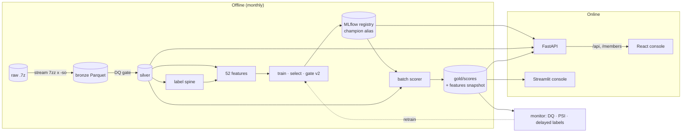
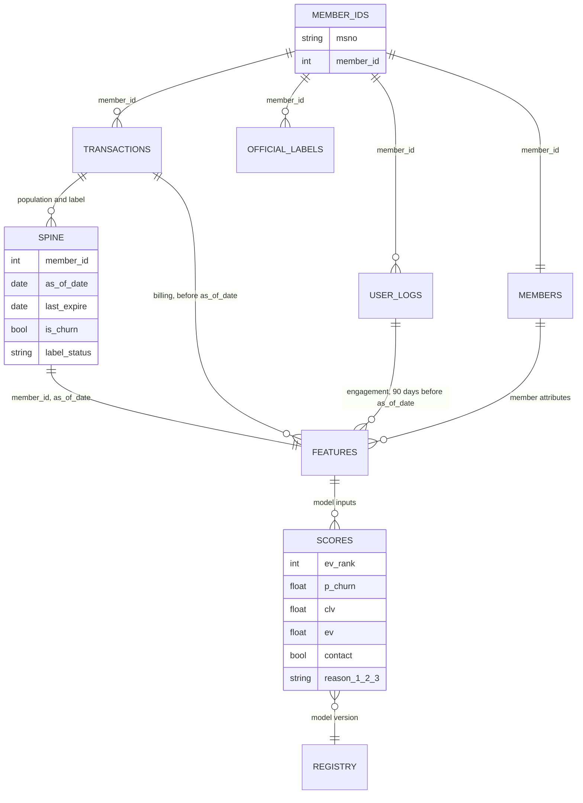

<p align="center">
  
</p>

<p align="center">
  <a href="https://github.com/anurag-23werty/ChurnGuard/actions/workflows/ci.yml"></a>
  
  
  
  
</p>

<p align="center">
  
  
  
  
  
  
  
  
  
  
  
  
  
</p>

<p align="center">
  <b>Which subscribers are about to cancel, and which of them are worth paying to keep?</b><br>
  An end-to-end, production-style ML system on the KKBox music-subscription dataset: out-of-core data
  engineering, leak-proof point-in-time features, a robust and calibrated model, expected-value
  retention targeting, an API, two consoles and monitoring that knows the difference between
  data drift and concept drift.
</p>

<p align="center">
  <a href="#-results-at-a-glance">Results</a> ·
  <a href="#-architecture">Architecture</a> ·
  <a href="#-data-and-how-it-connects">Data</a> ·
  <a href="#-the-build-phase-by-phase">Phases</a> ·
  <a href="#-models-and-metrics">Models</a> ·
  <a href="#-why-this-and-not-that">Decisions</a> ·
  <a href="#-run-it-locally">Run it</a>
</p>

---

## ✨ Results at a glance

| | Result |
|---|---|
|  | **410M raw rows** ingested in ~4.5 min without ever unpacking a CSV to disk; 155.5M-row log window; silver build in **46 s** |
|  | KKBox's official Scala labeller ported to SQL: **99%** population match, **96–98%** label agreement |
|  | **52 point-in-time features**; three leakage tests, each proven by deliberately breaking the code |
|  | Champion **logistic regression**: mean out-of-time AUC **0.896**, worst month **0.832**; March holdout **0.853** AUC (official labels, excl. early renewers) |
|  | EV targeting contacts **1.4%** of members for **+976k NTD** on the Feb backtest, beating risk-ranking and any fixed cut-off |
|  | **1,012,577** April members scored in **19 s**; API ~90 ms, **bit-identical** to batch; Docker healthy |
|  | April **ok** (score PSI 0.008); the replay proved Dec 2016 was **concept drift**, which only delayed labels can catch |
|  | React web console (7 pages) and Streamlit console, both reading only real pipeline outputs |
|  | **135 Python + 9 web tests**, warnings are errors, 4-job CI on every push |

---

## 🏗 Architecture

<p align="center">
  
</p>

The whole system is one reproducible chain of `make` targets (`make pipeline`). Each step writes
to a staging directory and publishes atomically, so a failed run never leaves half-written
outputs. Design notes and what changed while building are in [docs/ARCHITECTURE.md](docs/ARCHITECTURE.md).



---

## 🔗 Data and how it connects

Five raw files from the [WSDM KKBox churn competition](https://www.kaggle.com/c/kkbox-churn-prediction-challenge),
all keyed by an opaque member string `msno`:

| Raw file(s) | Grain | Key columns | Rows (bronze) | Used for |
|---|---|---|---|---|
| `members_v3.csv` | one row per member | `city`, `bd` (age), `gender`, `registered_via`, `registration_init_time` | 6,769,473 | member features, tenure |
| `transactions.csv` + `_v2` | one row per payment or cancellation | `payment_method_id`, `payment_plan_days`, `plan_list_price`, `actual_amount_paid`, `is_auto_renew`, `transaction_date`, `membership_expire_date`, `is_cancel` | 22,978,755 | **labels**, population, billing features |
| `user_logs.csv` + `_v2` | one row per member per listening day | `num_25/50/75/985/100` (plays by completion), `num_unq`, `total_secs` | 155,544,791 (Jul 2016–Mar 2017 window) | engagement features |
| `train.csv` + `train_v2.csv` | one row per member per label month | `is_churn` | 1,963,891 | validating our labels; the official **test** labels |
| `sample_submission_v2.csv` | April 2017 members | `msno` | 907,471 | checking the serving population |

**How the tables join.** `msno` (44-character base64) is mapped once to an append-only
`int32 member_id` in silver, which shrank `user_logs` from 6.4 GB to 1.4 GB and makes every join
an integer join. Everything downstream is keyed by **(member_id, as_of_date)**: the decision
date is the first day of the month the plan expires, and *every* source is filtered to events
strictly before it.



**Storage layers** (`data/`, never committed):

| Layer | Path | What is in it |
|---|---|---|
| raw | `data/raw/*.7z` | archives as downloaded, read-only; archived to Google Drive and hash-verified |
| bronze | `data/bronze/<table>/month=YYYY-MM/<source>.parquet` | typed 1:1 copy, zstd, month-partitioned, `_manifest.json` reconciling rows read vs written |
| silver | `data/silver/<table>/` | cleaned, deduplicated, `member_id`-keyed, member-sorted logs |
| gold | `data/gold/{spine,features,scores}/` | label spine, 52 features per (member, month), monthly scores + feature snapshot |
| reports | `reports/{dq,labels,features,baselines,selection,decisioning,monitoring}/` | JSON/Markdown evidence for every number in this README |

---

## 🧱 The build, phase by phase

<p>


</p>

###  Raw → bronze

`7zz x -so` streams each archive straight into a pyarrow CSV reader, which writes typed,
zstd-compressed Parquet partitioned by month. **No CSV ever touches the disk** (user_logs is
~30 GB uncompressed; the laptop had 18 GB free). Pandera schemas validate a sample per file and
a DQ report gates the step (`reports/dq/<table>.json`: volume, nulls, ranges, duplicates).
Raw and bronze are then archived with rclone to Google Drive (`make archive LAYER=raw`),
verified by size and hash before anything local is freed.

###  Bronze → silver

| Table | Bronze rows | Silver rows | Bronze size | Silver size | Cleaning |
|---|---|---|---|---|---|
| user_logs | 155,544,791 | 155,544,791 | 6.4 GB | 1.4 GB | 37,244 `total_secs` clipped to [0, 86400] |
| transactions | 22,978,755 | 22,975,416 | 775 MB | 60 MB | 3,339 exact dups dropped; 1,776 year-1970 expiries nulled |
| members | 6,769,473 | 6,769,473 | 225 MB | 36 MB | 4.55M ages outside 10–80 nulled |
| labels | 1,963,891 | 1,963,891 | 62 MB | 5.7 MB | |

Full silver build: **46 s** with DuckDB at a 6 GB memory cap.

###  Point-in-time label spine

KKBox's definition: a member whose plan **expires in month M** churns if there is **no new
valid subscription within 30 days**. Rather than use only the 2M official labels, the official
`WSDMChurnLabeller.scala` is ported to SQL and applied to every month, giving ~5.9M labelled
member-months, with two measured improvements:

- **Population:** any transaction before M that expires in M (the Scala file looks only at M-1's
  last transaction). Recall vs the official files: 86% → **99%**.
- **Label maturity:** a row is `decided` only if expiry + 30 days lies inside the data, else
  `pending`. Unseen renewals are never counted as churn.

| Month | Members | Pending | Churn (decided) | Official population recall / precision | Label agreement |
|---|---|---|---|---|---|
| 2016-10 | 944,849 | 1,224 | 4.52% | | |
| 2016-11 | 1,000,052 | 1,489 | 9.44% | | |
| 2016-12 | 991,108 | 1,821 | 8.42% | | |
| 2017-01 | 977,500 | 2,534 | 5.41% | | |
| 2017-02 | 984,196 | 4,395 | 4.71% | 99.1% / 99.9% (train.csv) | 98.0% |
| 2017-03 | 991,602 | 49,676 | (immature) | 98.7% / 96.6% (train_v2) | 96.0% |

About a third of the disagreements are "renewed then cancelled, never renewed again", which the
official labels count as churn and the Scala logic does not. March needs April data to mature,
so the March holdout is scored against the **official** train_v2 labels.

###  52 leak-proof features

`src/churnguard/features/registry.yaml` is the contract (family, source, window, dtype,
description); the builder refuses unregistered or missing columns. Families: **member** (7),
**billing** (24), **engagement** (21, windows capped at 90 days by log coverage). About 1M
rows per month in ~4.5 s.

<details>
<summary><b>How leakage is ruled out (4 defences, each mutation-tested)</b></summary>

| Defence | What it does | Proven by |
|---|---|---|
| Poisoned future | plants extreme events on/after `as_of_date` in every source (a 10M-second listening day, a 9,999 NTD cancellation); features must be byte-identical | deleting a date guard makes it fail |
| Mixed as-of dates | scores one member at two dates in one query; the earlier row must not see the later events (the case serving and backfills hit) | caught the 2 guard deletions the poison test missed; forced keying by (member_id, as_of_date) |
| Late registrations | `registration_date` after `as_of_date` gives NULL tenure | test |
| Leak smell test | `make feature-report` fails if any single feature has AUC ≥ 0.95 | current max `auto_renew_share_180d` 0.775 |
| Permutation control | logreg on 5 shuffled-label copies must average ≈ 0.5 and lose to the real model | 0.483 ± 0.025 SE vs 0.893 |

</details>

###   Models

See [Models and metrics](#-models-and-metrics) below: five learners, three baselines, a
sanity dataset and a promotion gate.

###  Expected-value retention

Contacting member *i* is worth

```
EV = p(churn) × save_rate × CLV − cost
CLV  = plan-normalised monthly revenue over 12 months, discounted by 6% baseline monthly churn (9.3 expected months)
cost = 2 NTD contact + one free month
```

Members with EV ≤ 0 are never contacted; under a budget, selection is greedy by EV / cost
(`decisioning/retention.py`, parameters in `configs/base.yaml: retention`).

**Backtest** (`make backtest`): the champion scores Feb 2017 (979,801 members, 4.7% churn) and
value is realised against what members actually did, at a 20% save rate.

| contact top x% | by expected value | by churn risk | random |
|---|---|---|---|
| 1% | **+801k NTD** | +647k | −1.2M |
| 2% | **+969k** | +963k | −2.4M |
| 5% | −466k | −638k | −5.9M |
| 10% | −5.2M | −6.0M | −11.8M |
| 30% | −24.6M | −31.0M | −35.3M |

- **The EV rule sizes the campaign by itself:** contacting only positive-EV members picks 1.4%
  (13,865) and realises **+976k NTD**, more than the best fixed cut-off found in hindsight (2%,
  +969k). That only works because probabilities are calibrated (ECE 0.006).
- **Value beats risk:** +24% at 1%, and it loses less past the optimum. Risk ranking alone spends
  offers on members who pay little or nothing.
- **A free month is expensive:** contacting everyone would lose 117M NTD.

| assumed save rate | break-even churn risk (149 NTD plan) | contacted | realised net value |
|---|---|---|---|
| 10% | 1.16 (impossible) | 0 | 0: no campaign |
| 20% | 0.58 | 13,865 (1.4%) | +976k NTD |
| 30% | 0.39 | 24,704 (2.5%) | +2.84M NTD |

KKBox has no campaign data, so the save rate is an **assumption**. The ranking holds in 18 of 18
cases (EV ≥ risk > random at every save rate and contact fraction); the money figures do not.
The first real campaign must keep a randomised holdout to measure it.

###  Batch + API

One scoring path, two entry points (`serving/scoring.py`): population → `feature_sql` (the
training feature code) → `prepare_features` (the training dtypes) → champion model → expected
value + contact decision → top-3 reason codes.

| April 2017 batch (`make score`) | |
|---|---|
| members scored | **1,012,577 in 19 s** (2.9 GB peak) |
| vs Kaggle's April test population | 100% recall, 89.6% precision |
| contact (positive EV) | 13,893 (1.4%); lowest contacted p = 0.579, the 0.58 break-even |
| expected net value (20% save rate) | +720k NTD |
| top reason among contacted | `last_is_cancel` (84%), `last_is_auto_renew` (16%) |

<details>
<summary><b>API endpoints</b> (<code>make serve</code>, OpenAPI at <code>/docs</code>)</summary>

| Endpoint | Purpose |
|---|---|
| `GET /health` | live model name, version, type, run id, alias |
| `GET /members/{id}/score?as_of=` | builds that member's features from silver as of the date and scores them (~90 ms) |
| `POST /score` | caller-supplied features; schema generated from the registry, so a missing or mistyped feature is a 422 |
| `GET /api/months`, `/api/overview` | scored months; KPIs, tiers, reason mix, score histogram |
| `GET /api/members`, `/api/members/{id}` | paginated, filtered, sorted scores; one member with the 52 inputs it was scored on |
| `GET /api/retention/plan?budget=`, `/api/export/contacts.csv` | re-run EV selection under a budget; CRM CSV of that list |
| `GET /api/history`, `/api/registry`, `/api/policy` | served + replayed months; MLflow versions and aliases; retention economics |
| `GET /api/reports/{selection,baselines,backtest,replay}`, `/api/monitoring/{month}` | the pipeline's reports, verbatim |

The `/api` routes are read-only: nothing is recomputed, and a missing artifact is a 404 naming
the `make` target that creates it.

</details>

**Parity is tested, not assumed:** `tests/test_serving.py` scores members through the API one
by one and requires p, EV, contact and reasons to equal the batch rows exactly. The batch also
saves `features.parquet`; re-scoring it reproduces all 1,012,577 April probabilities bit for bit.
Docker runs the API as a non-root user with a healthcheck and a read-only artifact mount.

###  Monitoring

`make monitor` returns **ok / warn / retrain** (exit code 3 on retrain, for a scheduler):

| Check | How | Retrain if | Warn if |
|---|---|---|---|
| data quality | volume vs reference, null-rate jumps, p in [0, 1] | p out of range | volume outside 0.5–2×, null jump > 0.10 |
| feature drift | PSI on the model's own view of the 52 inputs | ≥ 3 features PSI > 0.25 | any feature PSI > 0.25 |
| score drift | PSI of served probabilities vs the reference | PSI > 0.25 | PSI > 0.10 |
| performance | scores joined to labels as they mature | complete month AUC ≥ 0.03 below expected, or ECE > 0.02 | |

<details>
<summary><b>The replay: would monitoring have caught December 2016?</b> (no, and that is the finding)</summary>

| Month | vs | score PSI | features PSI > 0.25 | 0.10–0.25 | decision |
|---|---|---|---|---|---|
| Dec 16 | Oct–Nov | 0.003 | 0 | 2 | ok |
| Jan 17 | Nov–Dec | 0.011 | 0 | 2 | ok |
| Feb 17 | Dec–Jan | 0.007 | 0 | 1 | ok |
| Mar 17 | Jan–Feb | 0.015 | 0 | 3 | ok |
| Apr 17 | Feb–Mar | 0.006 | 0 | 1 | ok |

December's inputs looked like every other month; what changed was the relationship between
features and churn (**concept drift**), which PSI cannot see. Only the delayed-label rule
catches it: December's out-of-time AUC was 0.832 vs 0.896 expected, a 0.064 drop that triggers
**retrain** about 30 days after the month closes (encoded in `tests/test_monitor.py`).

Two bugs the monitor surfaced, both fixed: the clock feature `days_since_first_txn` drifted
every month (now `expected_drift` in the registry: reported, never alerting), and category codes
depended on which library wrote the Parquet (`"13.0"` vs `"13"`, fake PSI ~15; now canonicalised).

</details>

###  Consoles

**React web console** (`web/`, Vite + React 19 + TypeScript + TanStack Query, hand-written SVG
charts, dark violet/cyan design system). It reads everything through the API, so it shows
exactly what the pipeline produced and never invents a number.

| Page | Shows | You can |
|---|---|---|
| Overview | members scored, predicted churn, revenue at risk, contact list, model AUC; tiers, revenue exposure, trend, backtest, top reasons, health | drill into a risk tier |
| Customers | all 1M scored members, server-side paginated | search (ID prefix or msno), filter tier / contact list, sort, export CSV (with confirmation) |
| Customer detail | probability gauge, EV breakdown, recommended play, reason codes, all 52 inputs | re-score live through the API (parity check), copy msno |
| Predictions | batch summary, score histogram, registry versions, scoring history | score any member at any date |
| Retention | campaign planner, save-rate sensitivity, EV vs risk vs random | budget what-if, export that list |
| Model performance | per-month metrics for every candidate, gate verdicts, holdout, calibration, baselines, confusion matrix at top 10% | toggle metrics, candidates, test population |
| Monitoring | ok/warn/retrain, data quality, score + feature drift, label maturity, replay | switch report month, hide expected drift |

What the API cannot provide is shown as unavailable, not filled in: request latency and error
rates (no metrics endpoint) and uplift (no treatment/control data).

**Streamlit console** (`make console`): campaign list + CSV, budget re-selection, monitoring and
member lookup, for analysts; rendered headless in CI.

---

## 📊 Models and metrics

**Splits are by time, never random.** Every row carries its `label_month`; train is Oct 2016–Jan
2017 (1M-row sample of 3.9M decided rows), validation Feb 2017 (979,801), test Mar 2017
(958,189, **official** labels). Hyperparameter tuning uses expanding folds *inside* the training
months (Oct→Nov, Oct–Nov→Dec, Oct–Dec→Jan), and a test asserts no fold trains on the future.

### Every model that was tried

| Model | Role | Valid AUC (Feb) | Mean OOT AUC | Worst-month AUC | Mean PR AUC | Mean log loss | Outcome |
|---|---|---|---|---|---|---|---|
| Prior (everyone 7%) | log-loss floor | 0.500 | | | | 0.1945 (Feb) | baseline |
| Rule: auto-renew × cancel | the analyst's afternoon | 0.849 | | | | 0.1275 (Feb) | baseline |
| **Logistic regression** | interpretable linear | **0.893** | **0.896** | **0.832** | 0.696 | 0.1321 | 🏆 **champion** |
| LightGBM (Optuna, 25 trials) | main challenger | 0.915 | 0.892 | 0.781 | 0.705 | 0.1325 | ❌ worst month, log loss |
| LightGBM robust (regularised + monotone) | "fix the overfit" attempt | 0.914 | 0.891 | 0.782 | 0.706 | 0.1333 | ❌ worst month, log loss |
| Blend LightGBM + logreg | best of both | 0.908 | 0.896 | 0.806 | **0.707** | **0.1300** | ❌ worst month |
| Blend robust + logreg | | 0.907 | 0.895 | 0.807 | 0.707 | 0.1304 | ❌ worst month |
| Logistic regression on IBM Telco | code sanity check | 0.852 (expected 0.82–0.88) | | | | | ✅ code validated |
| Logreg on 5 shuffled labels | leakage control | 0.41–0.56, mean 0.483 | | | | | ✅ no leak |

<p align="center">
  
</p>

<details>
<summary><b>Full per-month tables</b></summary>

| ROC AUC by scored month | Nov 16 | **Dec 16** | Jan 17 | Feb 17 | mean | worst |
|---|---|---|---|---|---|---|
| logreg | 0.959 | **0.832** | 0.899 | 0.893 | 0.896 | **0.832** |
| lgbm | 0.964 | 0.781 | 0.908 | 0.915 | 0.892 | 0.781 |
| lgbm_robust | 0.964 | 0.782 | 0.906 | 0.914 | 0.891 | 0.782 |
| blend lgbm + logreg | 0.963 | 0.806 | 0.904 | 0.908 | 0.896 | 0.806 |
| blend robust + logreg | 0.963 | 0.807 | 0.903 | 0.907 | 0.895 | 0.807 |

| PR AUC by scored month | Nov 16 | Dec 16 | Jan 17 | Feb 17 | mean |
|---|---|---|---|---|---|
| logreg | 0.867 | 0.658 | 0.650 | 0.610 | 0.696 |
| lgbm | 0.872 | 0.657 | 0.654 | 0.638 | 0.705 |
| blend lgbm + logreg | **0.874** | **0.660** | **0.663** | 0.632 | **0.707** |

| Validation, Feb 2017 | ROC AUC | PR AUC | log loss | ECE | precision@10% | lift@10% |
|---|---|---|---|---|---|---|
| prior | 0.500 | 0.047 | 0.1945 | 0.023 | 0.047 | 1.0 |
| rule | 0.849 | 0.370 | 0.1275 | 0.015 | 0.308 | 6.5 |
| logistic regression | **0.893** | **0.610** | **0.1094** | **0.006** | 0.356 | **7.6** |

</details>

### Why logistic regression won

Promotion **gate v2** (`tracking.promotion_decision`) requires, over *every* out-of-time month:
mean PR AUC ≥ baseline + 0.005, mean log loss ≤ baseline, **worst-month ROC AUC within 0.01 of
the baseline's**, latest-month ECE ≤ 0.01, a passed permutation control, and beating the current
champion.

- The blends **do** win PR AUC every month, but in December 2016 they fall to 0.806 vs 0.832.
  A model that ranks well in steady months and degrades sharply in a shift month is the riskier
  one to put in front of a retention budget.
- **Regularisation and monotone constraints did not fix December** (0.782 vs 0.781), so it is
  not an overfit but a shift the trees cannot extrapolate.
- **Single-month gating is unsafe:** the first LightGBM won February by 0.022 AUC, was
  auto-promoted by a Feb-only gate, lost December by 0.051, and was demoted. That is why gate v2
  exists.
- **Calibration was tested, not assumed:** isotonic regression made the Feb holdout *worse*
  (ECE 0.0063 → 0.0073), so logreg's own probabilities are kept.
- **Reason codes come free:** coefficient × standardised value, summed back per feature, adds
  up exactly to the logit (tested), so every score is explainable to a CRM agent.

### Holdout: March 2017, official labels

| Logreg, Mar 2017 | ROC AUC | PR AUC | log loss | ECE | precision@10% | recall@10% | lift@10% |
|---|---|---|---|---|---|---|---|
| all members (958,189) | 0.799 | 0.485 | 0.2427 | 0.039 | 49.8% | 56.8% | 5.7 |
| excluding early renewers (873,726) | **0.853** | **0.527** | 0.2006 | 0.028 | 50.9% | 63.4% | **6.3** |

The validation → test drop (0.893 → 0.799) has two parts: ~0.036 is the **label definition**
(scoring Feb against official labels gives 0.856, because they also count renew-then-cancel as
churn), and ~0.058 is March itself. *Early renewers* (already paid past March, 8.8%) churn at
16.5% in the official labels vs 2.3% in February and no model ranks them better than chance:
the official labeller saw April events this dataset does not contain. They are reported
separately rather than allowed to dominate the number.

---

## ⚖️ Why this, and not that

| Decision | Chosen | Instead of | Why |
|---|---|---|---|
| Compute | **DuckDB** over Parquet | Spark, pandas | 155M-row joins out-of-core on a 16 GB laptop with a 6 GB cap; Spark is cluster overhead for one machine, pandas would not fit |
| Ingest | **streamed `7zz -so` → pyarrow** | unzip then read CSV | 30 GB of CSV would not fit on 18 GB free disk |
| Storage | **zstd Parquet, month-partitioned** | CSV, a database | columnar + partition pruning; 6.4 GB → 1.4 GB once `msno` became `int32` |
| Keys | **int32 `member_id`** | 44-char `msno` strings | 4.5× smaller logs, integer joins |
| Labels | **port of the official labeller, all months** | only the 2M official labels | 5.9M labelled rows, a real time series, and a check against the official files |
| Split | **by month, expanding folds** | random K-fold | random splits train on the future and overstate every metric |
| Champion | **logistic regression** | LightGBM / blends | best worst month (0.832 vs ≤ 0.807) at equal mean AUC; calibrated; exact reason codes |
| Promotion | **gate over every month (mean + worst)** | best validation month | a Feb-only gate promoted a model that failed December |
| Calibration | **only if it helps out of time** | always isotonic | it made the holdout worse |
| Explanations | **TreeSHAP via `pred_contrib`; coef × value for logreg** | the `shap` package | identical numbers, no heavy dependency |
| Targeting | **expected value** | top-k by churn risk | +24% at 1%, sizes the campaign itself, loses less when over-contacting |
| Drift | **own PSI (~30 lines)** | Evidently | the model's own view of inputs, no heavy dependency |
| Retrain trigger | **matured-label performance** | input drift alone | December 2016 was concept drift with stable inputs |
| Registry | **MLflow aliases (champion / challenger)** | file paths | serving loads `models:/churnguard@champion`; promotion and rollback are alias moves |
| Orchestration | **Makefile** | Prefect, Airflow | monthly batch on one machine; every step is still a separate, atomic target |
| UI | **React web console + Streamlit** | Streamlit only | Streamlit for analysts; a typed, designed web app for business users, on read-only endpoints |
| Cold storage | **rclone → Google Drive, hash-verified** | keep everything local | frees 17 GB; silver/gold stay local because the pipeline reads them constantly |

---

## 🚀 Run it locally

Python 3.11+ (developed on 3.13), [uv](https://docs.astral.sh/uv/), Node.js 20.19+ for the web
console. System tools: `brew install sevenzip rclone`, Docker Desktop for the container. A
Kaggle API token in `~/.kaggle/access_token`, with the competition rules accepted.

```bash
uv sync                          # or: pip install -r requirements.txt -r requirements-dev.txt
make check                       # ruff + 135 tests (what CI runs)

make download                    # data/raw/*.7z from Kaggle
make ingest                      # raw -> bronze + DQ gate   (MONTHS=2016-10:2017-03 for a smaller window)
make silver                      # bronze -> silver
make spine features feature-report
make baselines train select      # baselines, tuning, gate v2, MLflow registry
make backtest                    # EV vs risk vs random, save-rate sensitivity
make score                       # batch-score next month with the champion
make monitor                     # ok / warn / retrain
make pipeline                    # all of the above, end to end
```

**Consoles**

```bash
make serve                       # terminal 1: API on http://localhost:8000 (docs at /docs)
make web-install                 # once: npm ci
make web                         # terminal 2: React console on http://localhost:5173
make console                     # or the Streamlit console on http://localhost:8501
```

**Other targets:** `make docker-build docker-run`, `make mlflow-ui`, `make registry`,
`make monitor-replay`, `make archive LAYER=raw`, `make restore LAYER=bronze/user_logs`,
`make storage-status`, `make telco`, `make web-check`, `make help` for the full list.

<details>
<summary><b>Cold storage setup</b></summary>

Raw archives and bronze live on an rclone remote (Google Drive by default, `storage.remote` in
`configs/base.yaml`); silver and gold stay local. Configure a Drive remote named `gdrive` with
**your own OAuth client ID** and scope `drive.file`: files are only visible to the client ID
that uploaded them, so never upload with rclone's shared client. The OAuth app stays in Google
"Testing" mode, so tokens expire every 7 days: `rclone config reconnect gdrive:`.

</details>

---

## 🗂 Repository layout

```
configs/base.yaml            paths, DuckDB limits, splits, retention economics, monitoring thresholds
src/churnguard/
  data/                      catalog, 7z streaming, bronze, DQ, silver
  labels/spine.py            point-in-time label spine (official labeller port)
  features/                  registry.yaml, families (member / billing / engagement), builder, diagnostics
  modeling/                  baselines, Telco check, LightGBM + Optuna, candidates, out-of-time evaluation, selection
  decisioning/               expected value, budget selection, backtest
  serving/                   shared scoring path, batch job, FastAPI app, read-only console API
  monitoring/                PSI drift, delayed-label performance, decision rule, replay
  console/                   Streamlit console
  tracking.py                MLflow wrapper, promotion gate v2, champion/challenger aliases
  storage.py                 rclone cold storage with hash verification
web/                         React + TypeScript console (Vite)
tests/                       135 tests on synthetic fixtures (no dataset needed)
docs/                        ARCHITECTURE.md, animated diagrams
```

## ✅ CI and quality

`.github/workflows/ci.yml` runs on every push and PR:

| Job | Checks |
|---|---|
|  | `uv sync --frozen`, ruff, 135 tests with 7-Zip and rclone installed; synthetic fixtures only, so a clean clone needs none of the 30 GB dataset |
|  | `requirements*.txt` must equal a fresh export of `uv.lock` |
|  | `npm ci`, strict typecheck, 9 unit tests, production build |
|  | image builds and imports the API and LightGBM (catches a missing `libgomp`) |

Pytest treats **warnings as errors**, so deprecations surface the day they appear.

## 🧭 Limitations and next steps

- **The save rate is an assumption.** Run the first campaign with a randomised holdout to measure
  it, then fit an uplift model on the treatment/control data.
- **Few months of history.** Four out-of-time months make "worst month" a noisy statistic;
  with more history the blend is the first challenger to re-test.
- **The clock feature** `days_since_first_txn` is capped by the dataset's start date; replace it
  with registration tenure in model v2.
- **Request metrics.** Add Prometheus middleware so the console can chart latency and error rates.
