# ChurnGuard: Architecture

End-to-end churn prediction and retention platform built on the KKBox (WSDM Cup 2018) dataset.
This document is the reference design. Each build phase below maps to one or more commits.

---

> Sections 1-4 are the original plan (Phase 0). Section 0 records what was actually
> built and where it deliberately diverged; the README has every number.

## 0. As built

| Area | Planned | Built | Why |
|---|---|---|---|
| Log window | all user_logs | 2016-07..2017-03 (155.5M rows) | 18 GB free disk; 90-day windows need only from July |
| Cold storage | - | rclone to Google Drive for raw + bronze (17 GB), verified by size + hash before local delete | disk; silver/gold stay local |
| Keys | msno | int32 `member_id`, append-only map | 6.4 GB -> 1.4 GB user_logs |
| Label population | official Scala (last txn in M-1) | any pre-M transaction expiring in M | official recall 86% -> 99% |
| Label maturity | - | per-row decided / pending | never count unseen renewals as churn |
| Main model | LightGBM | **logistic regression** champion | LightGBM won steady months but lost Dec 2016 by 0.051 AUC; gate v2 requires worst-month robustness |
| Calibration | always isotonic | only if it helps out of time | it worsened the Feb holdout, so not applied |
| SHAP | `shap` package | LightGBM `pred_contrib` (exact TreeSHAP); coef x value for logreg | same numbers, no heavy dependency |
| Promotion | best validation month | gate v2 over every out-of-time month (mean + worst) | a Feb-only gate promoted a fragile model |
| Drift | Evidently | own PSI (~30 lines) | no heavy dependency; model's view of inputs |
| Orchestration | Prefect | Makefile (`make pipeline`) | enough for monthly batch on one machine |
| UI | Streamlit | Streamlit console, plus a React web console (`web/`) on read-only `/api` endpoints | Streamlit for analysts; the web console for business users, reading the same artifacts |

Findings that changed the design along the way:

1. **Train/serve parity is enforced by construction and tested:** one population SQL,
   one feature SQL, one `prepare_features`, one model; the API reproduces batch scores
   exactly, and a feature snapshot reproduces served scores bit for bit.
2. **December 2016 was concept drift.** Input PSI stayed stable while AUC fell; only the
   delayed-label rule catches it. Monitoring therefore treats input drift as a pipeline
   health check and matured performance as the retraining signal.
3. **The save rate is an assumption.** KKBox has no campaign data; targeting ranks
   (EV > risk > random) are robust to it, money figures are not.

## 1. System diagram

```mermaid
flowchart LR
    %% ---------- SOURCES ----------
    subgraph SRC["Raw sources (Kaggle, 7z/CSV)"]
        M[members_v3.csv<br/>~6.8M members]
        T[transactions.csv + _v2<br/>~22M rows]
        L[user_logs.csv + _v2<br/>~400M rows / ~30 GB]
        Y[train.csv / train_v2.csv<br/>official labels]
        TEL[IBM Telco CSV<br/>sanity baseline]
    end

    %% ---------- INGESTION ----------
    subgraph ING["1 · Ingestion (bronze)"]
        I1[Streaming 7z → chunked reader<br/>no full CSV on disk]
        I2[Typed + validated<br/>Pandera schemas]
        I3[(Parquet, zstd<br/>partitioned by month)]
    end

    %% ---------- CLEAN ----------
    subgraph SIL["2 · Cleaning (silver)"]
        S1[Dedup, fix outliers<br/>age, negative secs, dates]
        S2[(silver Parquet)]
    end

    %% ---------- LABELS + FEATURES ----------
    subgraph GOLD["3 · Labels & point-in-time features (gold)"]
        LB[Label builder<br/>expiry in month M → churn if no<br/>renewal within 30 days]
        SN[Snapshot spine<br/>msno, cutoff_date, label]
        FE[DuckDB SQL feature pipelines<br/>windows 7/14/30/90/180d<br/>ALL data < cutoff_date]
        FR[Feature registry<br/>features.yaml: name, owner, window, SQL]
        FS[(Offline feature store<br/>Parquet per snapshot)]
    end

    %% ---------- TRAINING ----------
    subgraph TR["4 · Training & evaluation"]
        B0[Baselines<br/>rule-based, LogReg]
        B1[LightGBM + Optuna]
        CV[Rolling-origin backtest<br/>train ≤ M-1 → test M]
        CAL[Isotonic calibration]
        EV[Metrics: log loss, PR-AUC,<br/>lift@decile, retention $]
        SH[SHAP global + reason codes]
        MLF[(MLflow tracking<br/>+ model registry)]
    end

    %% ---------- DECISIONING ----------
    subgraph DEC["5 · Retention decisioning"]
        D1[Expected value per member<br/>p_churn × CLV × uplift − cost]
        D2[Budget-constrained targeting<br/>top-K + segment playbooks]
    end

    %% ---------- SERVING ----------
    subgraph SRV["6 · Serving"]
        BS[Batch scorer<br/>daily, all active members]
        SC[(scores table<br/>DuckDB/Parquet)]
        OF[(Online feature snapshot<br/>SQLite / Redis)]
        API[FastAPI /predict /explain<br/>Docker]
        UI[Streamlit retention console]
    end

    %% ---------- MONITORING ----------
    subgraph MON["7 · Monitoring & feedback"]
        DQ[Data quality checks<br/>volume, nulls, schema]
        DR[Drift: PSI / Evidently<br/>features + score dist]
        PF[Delayed-label performance<br/>labels land +30d]
        AL[Alerts → retrain trigger]
    end

    %% ---------- PLATFORM ----------
    subgraph OPS["Platform"]
        ORC[Orchestration: Prefect / Makefile]
        CI[CI: GitHub Actions<br/>ruff, pytest, leakage tests]
    end

    M & T & L & Y --> I1 --> I2 --> I3 --> S1 --> S2
    S2 --> LB --> SN
    SN --> FE
    S2 --> FE
    FR -. defines .-> FE
    FE --> FS
    TEL -. sanity check .-> B0
    FS --> B0 & B1
    B1 --> CV --> CAL --> EV
    CAL --> SH
    B0 & EV & SH --> MLF
    MLF -- "Production model" --> BS
    FS --> OF
    OF --> API
    MLF -- "Production model" --> API
    BS --> SC --> D1 --> D2 --> UI
    API --> UI
    I3 --> DQ
    FS --> DR
    SC --> DR
    SC --> PF
    Y -. new labels .-> PF
    DQ & DR & PF --> AL
    AL -- retrain --> B1
    ORC -. schedules .-> ING & SIL & GOLD & TR & SRV & MON
```



### Medallion layout on disk

```
data/
  raw/        7z archives as downloaded (read-only, never modified)
  bronze/     typed Parquet, 1:1 with source, partitioned by month
  silver/     cleaned Parquet
  gold/
    spine/    (msno, cutoff_date, is_churn) per snapshot month
    features/ one Parquet per snapshot month
  serving/    scores, online feature snapshot
```

---

## 2. Key design decisions

### 2.1 Churn definition and the snapshot spine
KKBox defines churn as: a member whose subscription **expires in month M** and who does **not**
make a new valid subscription within **30 days** of expiry.

Rather than training on the single official label file, we rebuild labels from `transactions`
for several months (e.g. 2016-10 → 2017-03). Each row in the spine is
`(msno, cutoff_date = membership_expire_date, is_churn)`. This gives us:
- multiple training snapshots (more data, seasonality),
- a proper **rolling-origin backtest** instead of a random split,
- a check against the official `train_v2` labels to validate our label logic.

### 2.2 Point-in-time correctness (the thing interviewers probe)
Every feature for a snapshot is computed with `event_date < cutoff_date`. Concretely:
- **Transactions after cutoff are excluded.** The renewal transaction *is* the label; the
  famous KKBox leak comes from features that peek at it (e.g. "latest expire date",
  "number of transactions" computed on the full table).
- **Snapshots are never mixed across a split boundary.** Train on months ≤ M-1, test on M;
  the same member can appear in both, but only with features up to their own cutoff.
- A **leakage test suite** in CI asserts `max(event_date) < cutoff_date` for every feature
  table and that shuffled-label models score ~0.5 AUC.

### 2.3 Data engineering under real constraints
Target machine: 16 GB RAM, 8 cores, **~18 GB free disk**. `user_logs.csv` is ~30 GB
uncompressed, so it never lands on disk as CSV:
- stream-decompress (`7z x -so`) into a chunked reader → write zstd Parquet by month
  (expected ~4-6 GB total),
- all heavy aggregation in **DuckDB** over Parquet (out-of-core, multi-threaded,
  `memory_limit` set), never `pd.read_csv` on the full log,
- configurable `--months` window so the pipeline can run on a 3-6 month sample first.

### 2.4 Features (initial set)
| Family | Examples |
|---|---|
| Member | tenure, city, registered_via, age (cleaned), gender missingness |
| Billing | plan days, list vs paid price, discount, auto-renew, #cancels, payment method, days since last transaction |
| Engagement | total_secs, num_unq, completion ratio (num_100 / all), active days in 7/30/90d |
| Trends | 7d vs 30d engagement ratio, slope of daily secs, days since last listen |
| Lifecycle | days to expiry, renewals count, previous churn-and-return |

### 2.5 Modelling
- Baselines first: "auto_renew=0 and is_cancel=1" rule, then logistic regression.
- LightGBM as the main model; Optuna tuning on the backtest folds.
- **Isotonic calibration**: downstream decisioning multiplies probabilities by dollars,
  so calibration matters more than AUC.
- Metrics: log loss (competition metric), PR-AUC (imbalance ~6-9% churn), lift and
  precision in the top decile, and a **retention-value curve** (net $ saved vs. % contacted).
- SHAP for global importance and per-member top-3 reason codes.

### 2.6 Serving
Churn is a batch problem in practice, so the primary path is a **daily batch scorer**.
A FastAPI service exposes `/predict` and `/explain` per `msno` backed by an online feature
snapshot, to demonstrate a real-time path and the training/serving parity check
(same feature code, tested to produce identical vectors).

### 2.7 Monitoring
- Data quality on each ingest: row counts vs. trailing mean, null rates, schema.
- Drift: PSI per feature and on the score distribution (Evidently report).
- **Delayed labels**: true churn is known 30 days after expiry, so performance monitoring
  joins scores to labels as they mature; degradation beyond threshold triggers retraining.

---

## 3. Tech stack

| Layer | Choice | Why |
|---|---|---|
| Storage | Parquet (zstd) | columnar, compressed, partition pruning |
| Compute | DuckDB, Polars/pyarrow | out-of-core SQL on a laptop |
| Validation | Pandera | typed schemas in Python |
| Modelling | scikit-learn, LightGBM, Optuna, SHAP | industry standard for tabular |
| Tracking | MLflow | experiments + model registry |
| Serving | FastAPI, Docker | lightweight, typed API |
| UI | Streamlit | retention console |
| Monitoring | Evidently | drift reports |
| Orchestration | Makefile → Prefect | simple first, schedulable later |
| Quality | ruff, pytest, pre-commit, GitHub Actions | CI hygiene |

---

## 4. Build phases

| # | Phase | Deliverable |
|---|---|---|
| 0 | Architecture & scaffold | this doc, repo layout, env, config |
| 1 | Ingestion | raw → bronze Parquet, schemas, DQ checks |
| 2 | Cleaning | bronze → silver |
| 3 | Labels | spine builder, validated against official `train_v2` |
| 4 | Features | DuckDB feature pipelines + registry + leakage tests |
| 5 | Baselines | Telco sanity check, rule + LogReg on KKBox |
| 6 | Main model | LightGBM, backtest, calibration, SHAP, MLflow |
| 7 | Decisioning | expected value, budget-constrained targeting |
| 8 | Serving | batch scorer, FastAPI, Docker |
| 9 | Monitoring | drift, delayed-label performance, retrain trigger |
| 10 | UI & polish | Streamlit console, CI, README results |
